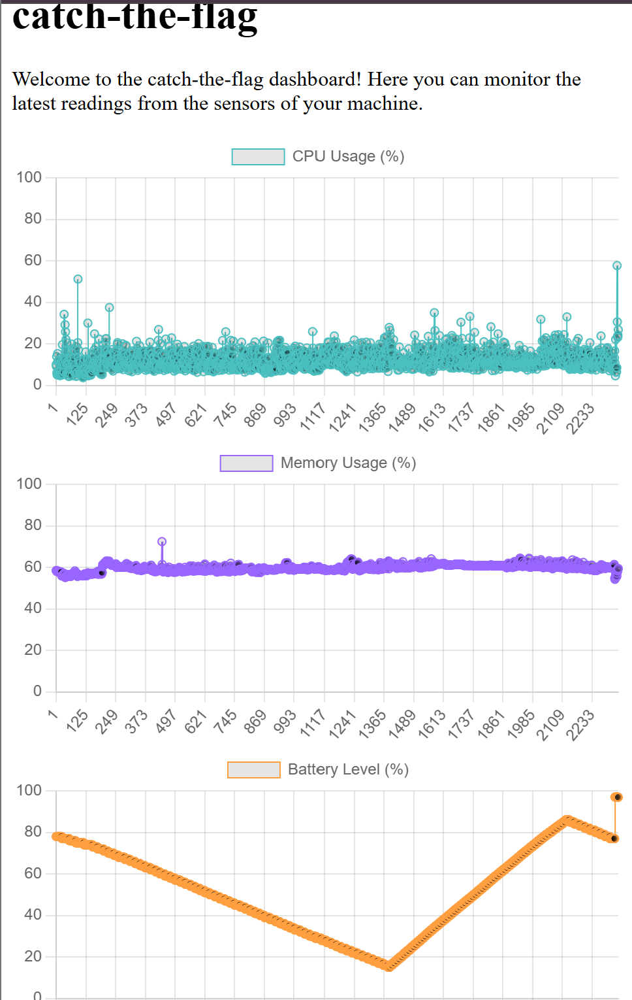

# catch-the-flag

A real-time computer monitoring system.
A lightweight agent watches my machine and streams live stats to a web dashboard.

## What it does

- Agent collects CPU, memory, and battery stats every few seconds
- Backend (FastAPI) receives the stats over REST and stores them
- Database (SQLite) keeps the full history — readings survive restarts and power-downs
- Dashboard draws live charts that refresh every 3 seconds

## Architecture
- agent (psutil) → HTTP POST → FastAPI → SQLite → live Chart.js dashboard

## API endpoints

| Endpoint | What it does |
|---|---|
| `GET /health` | Liveness check — returns `{"status": "ok"}` |
| `GET /metrics` | Live CPU + memory, right now |
| `POST /metrics/ingest` | The agent delivers a reading |
| `GET /metrics/readings` | The last 50 stored readings |

## How to run it

Install the dependencies:

 pip install fastapi uvicorn psutil requests

Terminal 1 — start the server:

    python -m uvicorn backend.main:app --reload

Terminal 2 — start the agent:

    python agent/agent.py

Then open http://127.0.0.1:8000/ in your browser.

## Project structure

    agent/agent.py        — the metrics agent
    backend/main.py       — FastAPI server + SQLite storage
    dashboard/index.html  — the Chart.js dashboard

## Built with

Python · FastAPI · psutil · SQLite · Chart.js
