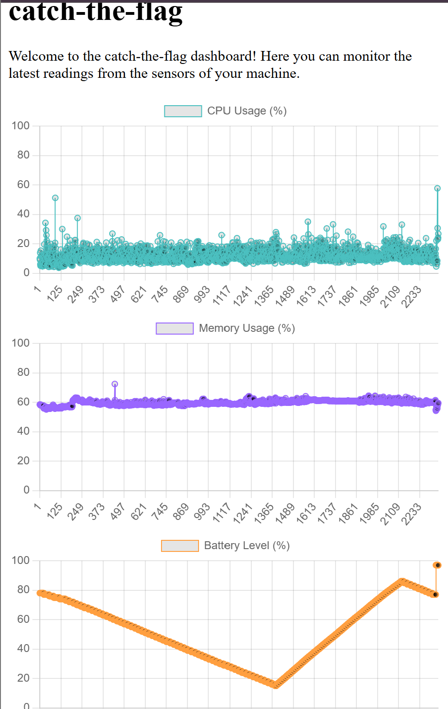
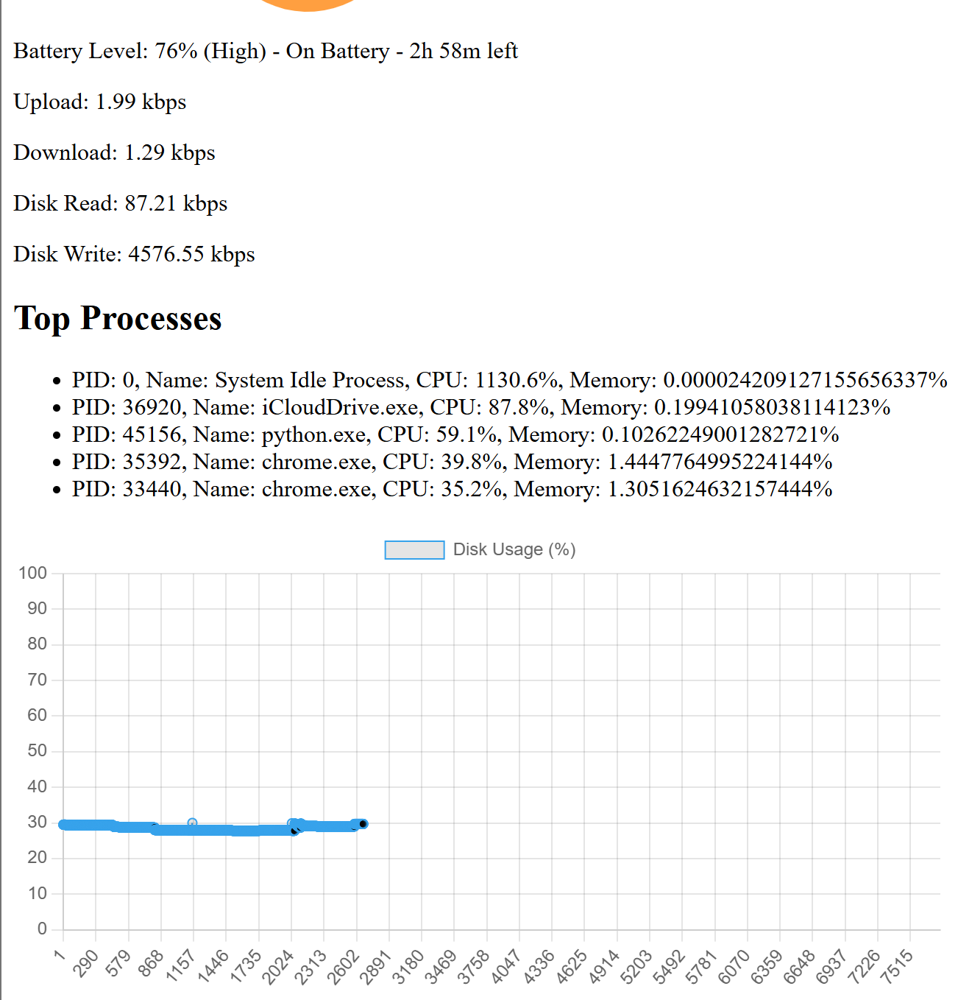

# catch-the-flag

A real-time computer monitoring system.
A lightweight agent watches my machine and streams live stats to a web dashboard.





## What it monitors now

 - CPU and memory — live percent, with history charts
 - Battery — live level with a doughnut gauge, plus plugged-in status and time left
 - Disk usage — C: drive percent used, with a history chart
 - Disk read/write speeds — live disk read and write speeds (KB/s)
 - Network speeds — live upload and download speeds (KB/s)
 - Top processes — top 5 processes by CPU, with memory use

## Architecture
- agent (psutil) → HTTP POST → FastAPI → SQLite → live Chart.js dashboard

The agent polls the machine, POSTs each reading to the backend, the backend stores it in SQLite, and the dashboard pulls the latest readings and renders them as charts and readouts.

## API endpoints

| Endpoint | What it does |
|---|---|
| `GET /health` | Liveness check — returns `{"status": "ok"}` |
| `GET /metrics` | Latest live reading, including battery state |
| `POST /metrics/ingest` | Agent posts a new reading |
| `GET /metrics/readings` | Stored reading history |

## How to run it

Install the dependencies:

 ```bash
   pip install fastapi uvicorn psutil requests
```

Terminal 1 — start the server:

    python -m uvicorn backend.main:app --reload

Terminal 2 — start the agent:

    python agent/agent.py

Then open http://127.0.0.1:8000/ in your browser.

## Project structure

    agent/agent.py        # polls psutil and POSTs readings
    backend/main.py       # FastAPI app + SQLite storage
    dashboard/index.html  # live Chart.js dashboard
    requirements.txt      # fastapi, uvicorn psutil, requests

## Built with

Python · FastAPI · psutil · SQLite · Chart.js

What's next:

Threshold alerts (for example, a banner when CPU goes over a set level), then a styling pass on the dashboard.